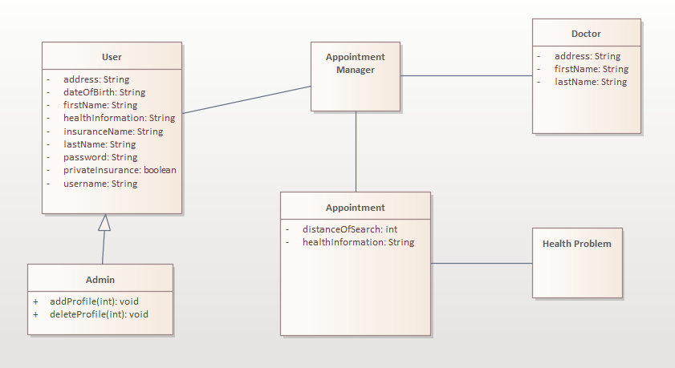

# Smart E-Health Consulting System

Eine Desktop-Anwendung in Java (Swing), mit der Patienten Arzttermine passend zu ihren Beschwerden buchen. Sie findet Fachärzte im gewünschten Umkreis, bestätigt Termine per E-Mail und erinnert rechtzeitig daran.

Entstanden als Gruppenprojekt mit vier Personen im Modul „Object-Oriented Programming in Java – Advanced Course“ im Wintersemester 2021/22.

## Funktionen

- **Konten:** Registrierung und Login. Passwörter werden gehasht in der Datenbank gespeichert.
- **Admin-Bereich:** Alle Profile ansehen, bearbeiten und löschen.
- **Termin buchen:** Passend zur Beschwerde werden Fachärzte im gewählten Suchradius aufgelistet, mit Kartenansicht.
- **Bestätigung per E-Mail** mit Arzt, Adresse, Datum und Uhrzeit.
- **Erinnerungen** per E-Mail, wahlweise eine Woche, drei Tage, eine Stunde oder zehn Minuten vor dem Termin.
- **Termine verschieben oder absagen**, jeweils mit E-Mail an den Patienten.
- **Gesundheitsdaten exportieren** als PDF oder TXT.

## Technik

Java 17, Swing (IntelliJ GUI Designer), MySQL über JDBC, JavaMail, Quartz für die Erinnerungen, iText für den PDF-Export, JCalendar und JxMaps für die Karte

  

Die Aufgabenstellung steht in [eHealth.pdf](eHealth.pdf), die Projektdokumentation mit Anforderungen, Use Cases, Aktivitäts- und Sequenzdiagrammen in [javaProject.pdf](javaProject.pdf). Beide sind auf Englisch.

## Starten

Das Projekt ist ein IntelliJ-IDEA-Projekt. Die Oberflächen sind mit dem GUI Designer von IntelliJ gebaut, deshalb lässt es sich dort am einfachsten starten.

1. Den Ordner in IntelliJ IDEA öffnen und ein JDK 17 einstellen.
2. Die JARs aus `lib/` und `lib/Quartz/` als Bibliothek hinzufügen.
3. Eine MySQL-Datenbank anlegen und [`database.sql`](database.sql) importieren. Die Datei enthält die Tabellen und Beispieldaten für Ärzte und Beschwerden.
4. Die eigenen Zugangsdaten in `src/main/java/DatabaseConnector.java` und den Mail-Zugang in `src/Email/Mail.java` eintragen.
5. `src/main/java/Main.java` starten.

Die Kartenansicht nutzt die kommerzielle Bibliothek JxMaps und funktioniert nur mit einer gültigen Lizenz.
