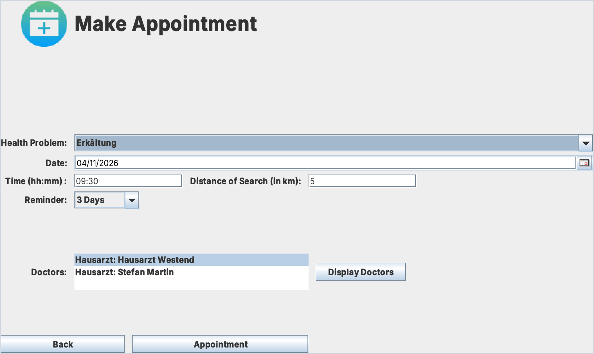
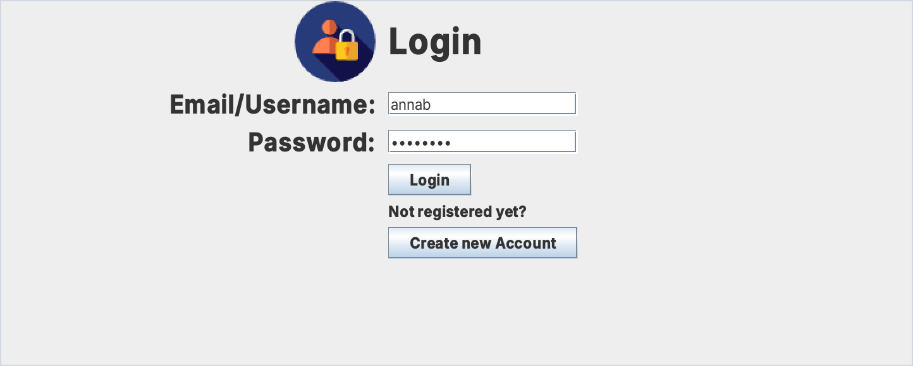
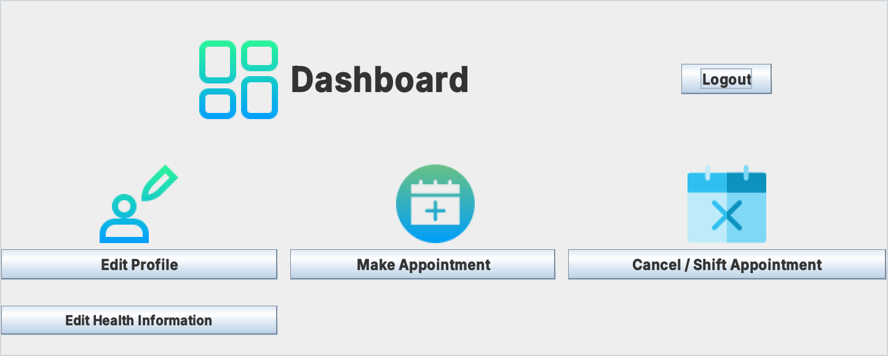
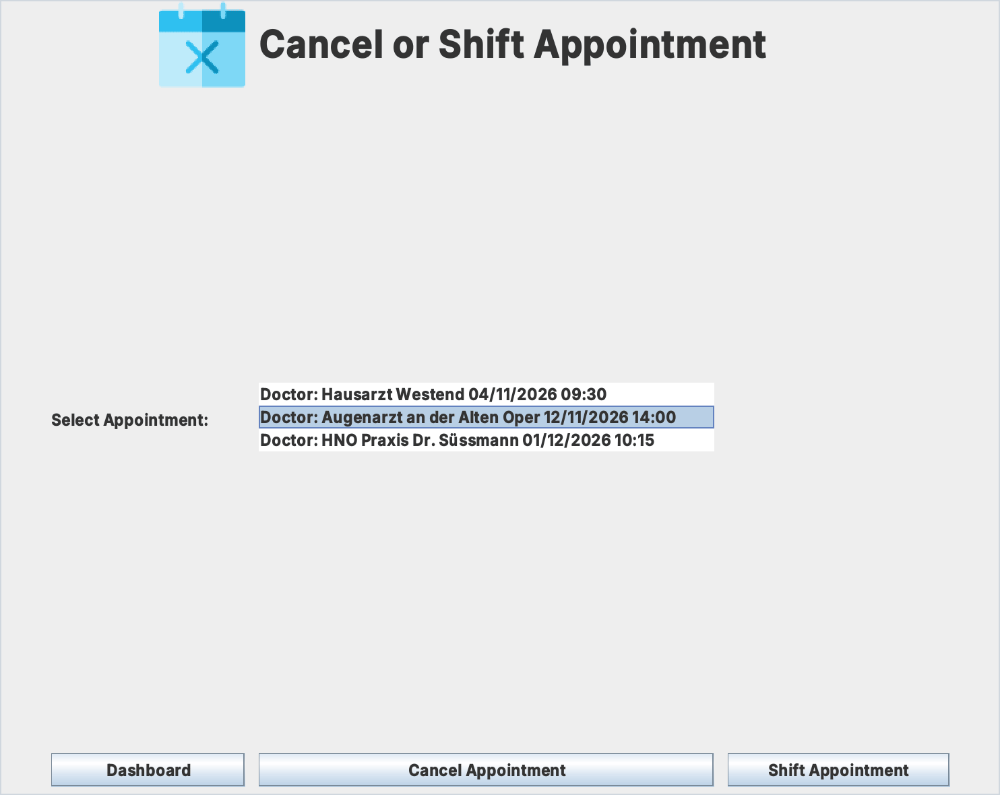
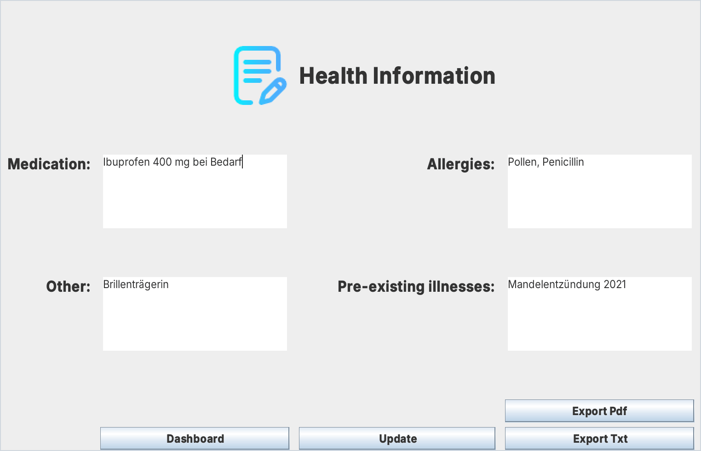
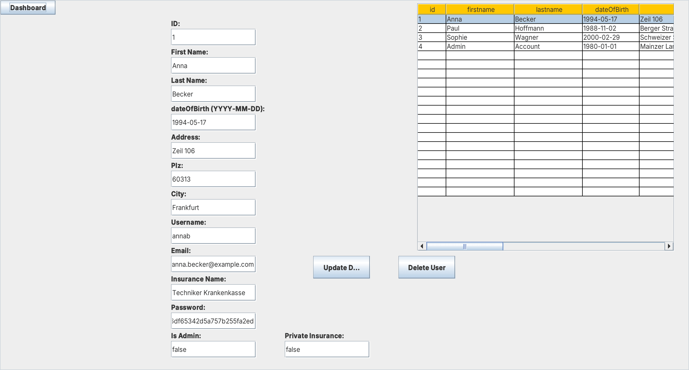

# Smart E-Health Consulting System

Eine Desktop-Anwendung in Java (Swing), mit der Patienten Arzttermine passend zu ihren Beschwerden buchen. Sie findet Fachärzte im gewünschten Umkreis, bestätigt Termine per E-Mail und erinnert rechtzeitig daran.

Entstanden als Gruppenprojekt mit vier Personen im Modul „Object-Oriented Programming in Java – Advanced Course“ im Wintersemester 2021/22.

  

## Funktionen

- **Konten:** Registrierung und Login. Passwörter werden gehasht in der Datenbank gespeichert.
- **Admin-Bereich:** Alle Profile ansehen, bearbeiten und löschen.
- **Termin buchen:** Passend zur Beschwerde werden Fachärzte im gewählten Suchradius aufgelistet. Die Entfernung zwischen Patient und Praxis berechnet die Anwendung aus den Adressen, die Koordinaten kommen von OpenStreetMap (Nominatim).
- **Bestätigung per E-Mail** mit Arzt, Adresse, Datum und Uhrzeit.
- **Erinnerungen** per E-Mail, wahlweise eine Woche, drei Tage, eine Stunde oder zehn Minuten vor dem Termin.
- **Termine verschieben oder absagen**, jeweils mit E-Mail an den Patienten.
- **Gesundheitsdaten** wie Medikamente, Allergien und Vorerkrankungen pflegen und als PDF oder TXT exportieren.

## Screenshots

<table>
  <tr>
    <td width="50%" align="center"> Login</td>
    <td width="50%" align="center"> Dashboard</td>
  </tr>
  <tr>
    <td width="50%" align="center"> Termine absagen oder verschieben</td>
    <td width="50%" align="center"> Gesundheitsdaten mit Export</td>
  </tr>
  <tr>
    <td colspan="2" align="center"> Admin-Bereich: Nutzer ansehen, bearbeiten und löschen</td>
  </tr>
</table>

Die Screenshots zeigen Beispielnutzer, die Ärzte und Beschwerden stammen aus [`database.sql`](database.sql).

## Technik

Java 17, Swing (IntelliJ GUI Designer), MySQL über JDBC, JavaMail, `java.util.Timer` für die Erinnerungen, iText für den PDF-Export, JCalendar für die Datumsauswahl, OpenStreetMap Nominatim für die Umkreissuche

  

Die Aufgabenstellung steht in [eHealth.pdf](eHealth.pdf), die Projektdokumentation mit Anforderungen, Use Cases, Aktivitäts- und Sequenzdiagrammen in [javaProject.pdf](javaProject.pdf). Beide sind auf Englisch.

## Starten

Das Projekt ist ein IntelliJ-IDEA-Projekt. Die Oberflächen sind mit dem GUI Designer von IntelliJ gebaut, deshalb lässt es sich dort am einfachsten starten.

1. Den Ordner in IntelliJ IDEA öffnen und ein JDK 17 einstellen.
2. Die JARs aus `lib/` und `lib/Quartz/` als Bibliothek hinzufügen.
3. Eine MySQL-Datenbank `ehealth` anlegen und [`database.sql`](database.sql) importieren. Die Datei enthält die Tabellen und Beispieldaten für Ärzte und Beschwerden.
4. Die eigenen Zugangsdaten in `src/main/java/DatabaseConnector.java` und den Mail-Zugang in `src/Email/Mail.java` eintragen.
5. `src/main/java/Main.java` starten.

Für die Umkreissuche braucht die Anwendung eine Internetverbindung, weil sie die Adressen bei OpenStreetMap nachschlägt.
